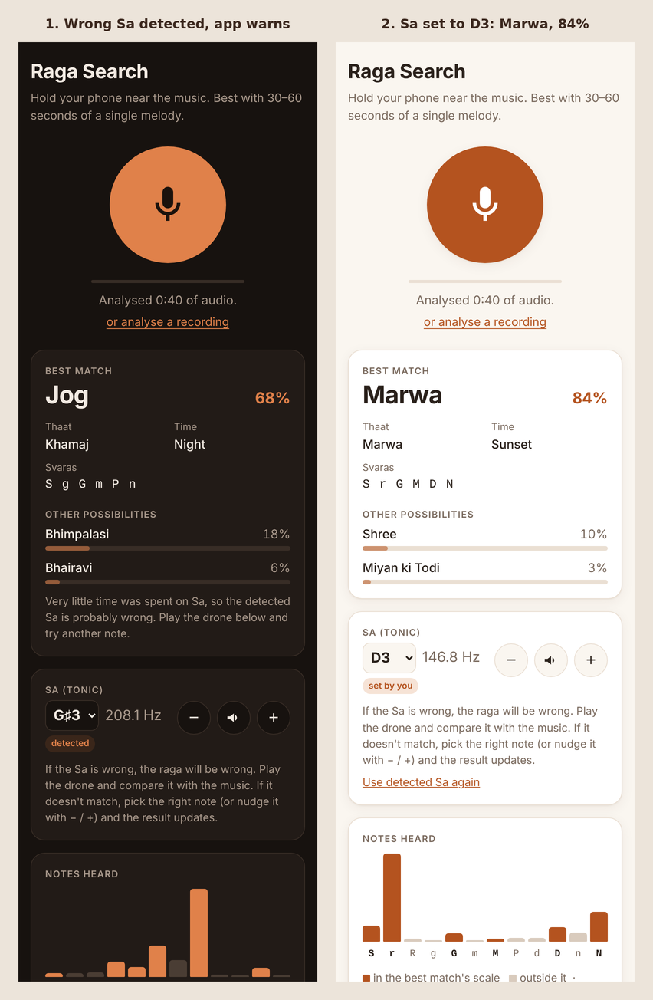
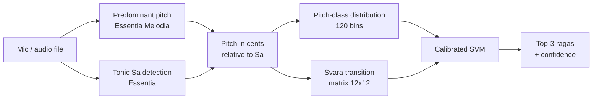

# Raga Search

[](https://github.com/adotmeg/ragasearch/actions/workflows/ci.yml)

[](LICENSE)

**Shazam for ragas.** Hold your phone up to a Hindustani classical performance and Raga Search tells you which raga is being sung, which notes it heard and what the tonic (Sa) is. The model is trained and evaluated on real concert recordings.



<sub>Screenshots use a model that never saw this performance: the recording was left out of its training data.</sub>

## Why this is harder than Shazam

Shazam matches the *exact recording*, so it can only identify a recording it already has. A raga is a melodic framework: every performance of Yaman is different, sung by a different artist at a different pitch, and mostly improvised. So instead of fingerprinting, Raga Search has to learn what makes a raga a raga: which notes it uses, which it stresses and how it moves between them. Everything is measured relative to the singer's tonic (Sa).

## How it works



1. **Pitch tracking** finds the main melody line, even with tabla and harmonium in the background.
2. **Tonic detection** finds Sa from the tanpura drone. Converting pitch to cents above Sa makes a male singer in C♯ and a female singer in G look the same.
3. **Features:** how much time is spent on each pitch, at 10-cent resolution, which captures intonation such as the very low komal Re of some ragas, plus how often the melody moves from each note to each other note.
4. **Classifier:** an SVM with calibrated probabilities, so the confidence shown in the app means something.

The web app records raw audio (with the browser's noise suppression and auto gain turned off, since they damage music), sends what it has heard every 5 seconds, and refines its answer for up to a minute.

## Results

On [Saraga](https://doi.org/10.5281/zenodo.4301737), an open dataset of annotated concert recordings: 21 ragas, 5-fold cross-validation, **tested only on artists the model never trained on**.

| Clip length | Top-1 | Top-3 |
|---|---|---|
| 10 s | 40.8% | 64.8% |
| 30 s | 52.6% | 71.9% |
| 60 s | 56.7% | 72.9% |

Chance is about 5%. Automatic Sa detection is right on 88% of 30-second clips and 95% of 2-minute clips. Most mistakes are between musically related ragas, such as Todi and Bilaskhani Todi, or Miyan ki Malhar and Ramdasi Malhar.

Full analysis, confusion breakdown and model comparison: [`docs/results_saraga_hindustani.md`](docs/results_saraga_hindustani.md) · Model card: [`models/README.md`](models/README.md)

## Design decisions

- **Evaluate on unseen artists.** Splitting clips randomly would put clips from the same concert in both training and test data and inflate accuracy. Grouping folds by artist gives the number a real user would actually see.
- **Report accuracy against listening time.** That curve set the app's behaviour: first guess at 8 s, refine until 60 s, and tell the user it's an early guess.
- **Measure tonic detection separately.** Failure analysis showed a wrong Sa makes the raga prediction useless. That led to the Sa picker, a drone to check Sa by ear, and an automatic warning when the music barely touches the detected Sa.
- **Keep the model simple and debuggable** before reaching for deep learning. With only 53 recordings, a small feature-based SVM is a sensible baseline: it trains in seconds, it compared well against kNN, and every error can be traced to the notes heard. A neural network is the next step once there's more data.
- **Frontend with no build step.** One HTML, CSS and JS page served by the API, so the whole app ships as one container.
- **Pin dependencies and test the shipped model.** The model is a scikit-learn pickle, so CI checks that the committed file still loads and predicts.

## Run it

**Docker** (includes the trained model):

```bash
docker build -t ragasearch .
docker run -p 7860:7860 ragasearch
# open http://localhost:7860
```

**Python 3.11+:**

```bash
python -m venv .venv && . .venv/bin/activate
pip install -r requirements-dev.txt
uvicorn api.main:app --reload        # http://localhost:8000
pytest                               # 14 tests, about 30 s
```

ffmpeg is optional and only needed to upload m4a/webm files. Browsers allow microphone access only on `https://` or `localhost`.

**API:**

```bash
curl -F "audio=@clip.wav" http://localhost:8000/identify
curl -F "audio=@clip.m4a" -F "tonic_hz=146.8" http://localhost:8000/identify   # with a known Sa
```

### Deploy for free (Hugging Face Spaces)

1. Create a new Space at huggingface.co/new-space and choose **Docker** as the SDK.
2. Upload the two files from [`deploy/huggingface/`](deploy/huggingface/) to the Space.

The Space builds the app from this repository and serves it over HTTPS, so the microphone works on phones.

## Reproduce the experiments

```bash
curl -L -o saraga.zip "https://zenodo.org/records/4301737/files/saraga1.5_hindustani.zip?download=1"   # 4 GB
unzip saraga.zip -d ~/mir_datasets/saraga_hindustani
python scripts/make_manifest_saraga.py ~/mir_datasets/saraga_hindustani --min-recordings 2 --out data/saraga_hindustani.csv
python scripts/extract.py data/saraga_hindustani.csv -j 4
python scripts/evaluate.py data/saraga_hindustani.csv --clip 10 30 60 --group-by artist
python scripts/check_tonic.py data/saraga_hindustani.csv --seconds 30 120 -j 4
python scripts/train.py data/saraga_hindustani.csv --clip 30 --hop 30 --out models/raga_saraga_hindustani_v1.joblib
```

No dataset? `python scripts/make_synthetic_demo.py` generates toy recordings to exercise the whole pipeline.

## Project structure

| Path | What it does |
|---|---|
| `ragaid/pitch.py` | Audio loading (with ffmpeg fallback), pitch tracking, tonic detection |
| `ragaid/features.py` | Cents conversion, pitch-class distribution, svara transitions, clipping |
| `ragaid/model.py` | `RagaClassifier`: fit, top-k, save and load |
| `ragaid/training.py` | Clip datasets, grouped cross-validation, confusion matrix |
| `ragaid/data.py` | CSV manifests, pitch cache, Saraga loader |
| `api/main.py` | FastAPI `/identify`, `/ragas`, `/health`; serves the web app |
| `app/` | Mobile web app: live listening, upload, Sa correction, notes chart |
| `scripts/` | Command-line tools: extract, train, evaluate, check tonic, identify |
| `tests/` | Unit and end-to-end tests, including the API and the shipped model |

## Limitations and roadmap

- Knows 21 ragas, learned from 10 artists. It always picks one of these, even for music outside them.
- Struggles with close relatives (Marwa / Lalit, Todi / Bilaskhani Todi). Next: a sequence model over the pitch contour to learn characteristic phrases (pakad).
- Mostly trained on vocal music with a tanpura. Next: source separation before pitch tracking, and more instrumental data.
- More data would help most: the weakest ragas have only two recordings. Next: a "Wrong? Tell us the raga" button to collect labelled clips.

## Credits and licenses

- Code: [MIT](LICENSE).
- Model: trained on **Saraga** (Bozkurt, Srinivasamurthy, Gulati & Serra, [doi:10.5281/zenodo.4301737](https://doi.org/10.5281/zenodo.4301737)), so `models/raga_saraga_hindustani_v1.joblib` is **CC BY-NC-SA 4.0**: non-commercial use only.
- Audio analysis by [Essentia](https://essentia.upf.edu) (**AGPL-3.0**). A public deployment must offer its source code, which the app's footer link does.
- Raga reference cards (thaat, time, svaras) in `ragaid/ragas.json` are short summaries and still need checking by a musician.
